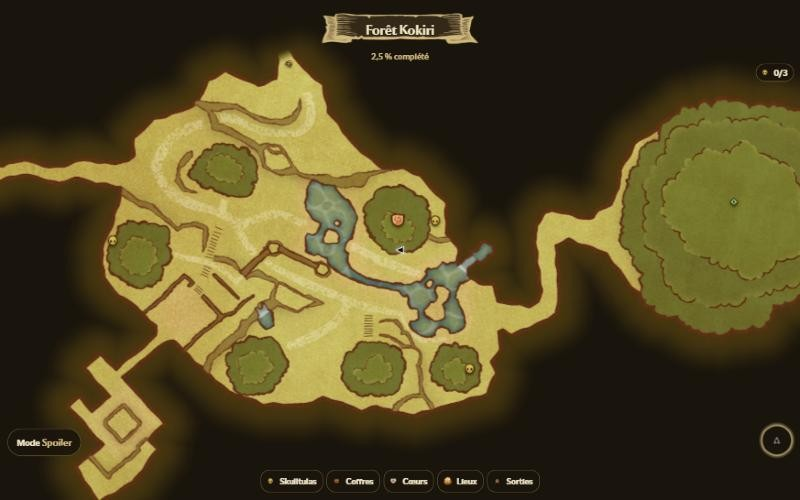
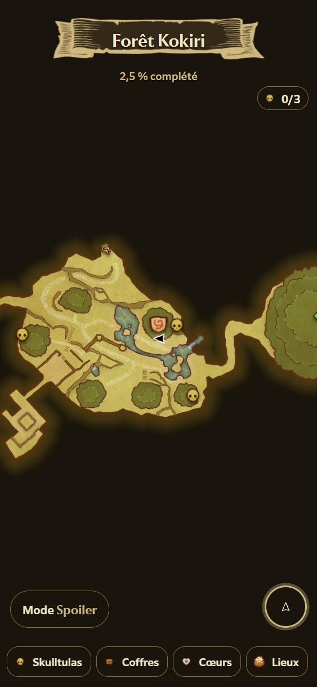
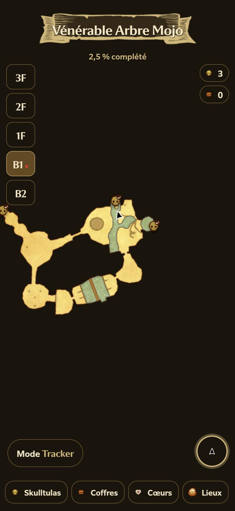
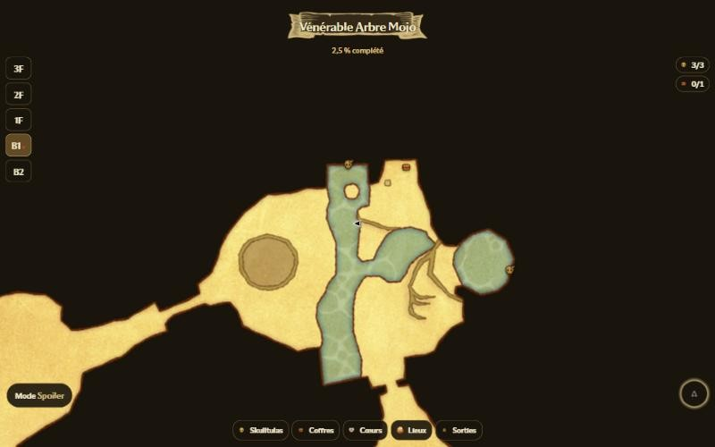
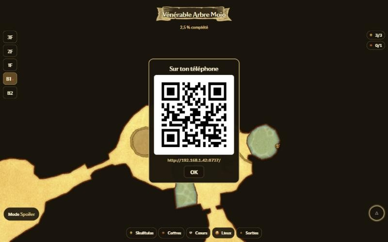

# Hookshot Notes

**La carte interactive d'Ocarina of Time, en direct sur ton téléphone.**

Hookshot Notes recrée la carte de *Zelda Notes* pour le remake Switch 2 d'**Ocarina of Time** joué sur PC avec
**[Hookshot](https://github.com/NotRexed/Hookshot)** : la carte de la zone où tu es, la position de Link en temps réel,
et tout ce qu'il reste à trouver (Skulltulas d'or, coffres, quarts de cœur…), dans le style du jeu, à ouvrir sur ton
téléphone ou un second écran pendant que tu joues.



<p align="center">
  
  &nbsp;&nbsp;
  
</p>

## Fonctionnalités

- 🗺️ **La carte de la zone actuelle**, avec les vraies cartes, icônes et polices du jeu. Elle suit Link toute seule,
  passe d'une zone à l'autre et choisit la version enfant ou adulte.
- 📍 **Link en direct** : sa flèche bouge sur la carte pendant que tu joues.
- 💀 **Skulltulas d'or, coffres, quarts de cœur, boutiques, fées, mini-jeux et sorties** de chaque zone.
- 🔀 **Deux modes** :
  - **Spoiler** : tout ce qu'il reste à trouver, avec une coche sur ce que tu as déjà pris, pour viser le 100 %.
  - **Tracker** : seulement ce que tu as déjà trouvé, pour garder la surprise.
- 🏰 **Donjons étage par étage** : un sélecteur d'étages, avec l'étage de Link marqué.
- 📈 **Pourcentage de complétion** et **lieux visités**. Touche le nom du lieu pour revoir une zone déjà visitée.
- 📱 **Sur téléphone, tablette ou second écran** : une simple page web, sans appli à installer, à ouvrir en scannant un
  QR code.



## Installation

> Il faut un PC Windows avec **Hookshot** déjà construit à partir de ta cartouche (mise à jour **2.0.0** du jeu).

1. Télécharge **`hookshot-notes.exe`** depuis la page [**Releases**](../../releases/latest).
2. **Double-clique dessus.** Tu peux le laisser où tu veux, par exemple dans Téléchargements.
   - Il trouve tout seul ton dossier Hookshot. S'il n'y arrive pas, il te demande une seule fois de le choisir
     (le dossier qui contient `romfs` et `hookshot.exe`).
   - La première fois, il prépare les cartes à partir de **ta** copie du jeu (environ une minute) et crée un raccourci
     **Hookshot Notes** sur le Bureau.
   - Si Windows affiche « Windows a protégé votre ordinateur », clique sur **Informations complémentaires**, puis
     **Exécuter quand même**. L'exe n'est pas signé, comme la plupart des outils de fans.
   - Si Windows demande d'autoriser l'accès au réseau, **autorise les réseaux privés**. C'est ce qui permet à ton
     téléphone de se connecter.
3. Le jeu se lance et une page s'ouvre sur ton PC avec un **QR code**. **Scanne-le avec ton téléphone**, qui doit être
   connecté au même Wi-Fi que le PC.



**Les fois suivantes**, utilise simplement le raccourci **Hookshot Notes** du Bureau : il lance le jeu et la carte
ensemble. Laisse la petite fenêtre noire ouverte pendant que tu joues.

## Utilisation

| | |
|---|---|
| **Déplacer / zoomer** | au doigt ou à la souris, comme une carte en ligne |
| **Recentrer sur Link** | le bouton rond en bas à droite (la carte recommence à suivre Link) |
| **Spoiler / Tracker** | le bouton en bas à gauche (le choix est retenu) |
| **Filtres** | les boutons du bas : Skulltulas, Coffres, Cœurs, Lieux, Sorties |
| **Autre lieu** | touche le nom du lieu en haut : la liste des lieux déjà visités s'ouvre |
| **Étages** | dans un donjon, les boutons à gauche ; le point rouge indique l'étage de Link |

Les compteurs en haut à droite montrent ta progression dans la zone. En mode Tracker, ils indiquent seulement ce que
tu as trouvé, sans le total.

## Comment ça marche

```
 ta copie du jeu (romfs)  ──► extraction au premier lancement ──► hookshot-notes-data/  (cartes, icônes, objets)
 le jeu qui tourne        ──► lecture de la mémoire (position de Link, zone actuelle)  ─┐
 ta sauvegarde            ──► objets ramassés                                          ─┼─► petit serveur local ──► page web
                                                                                         ┘     (Wi-Fi uniquement)
```

- **Les cartes et les objets** viennent des fichiers du jeu. Les images des cartes, la liste des coffres, Skulltulas
  et quarts de cœur avec leur position, ainsi que les caméras qui ont servi à dessiner les cartes, sont lues dans ta
  copie et converties une fois pour toutes.
- **La position de Link** est lue en direct dans la mémoire du jeu, à peu près deux fois par seconde. L'outil retrouve
  tout seul l'endroit où le jeu range « carte actuelle + position », même après un redémarrage du jeu.
- **Les objets ramassés** sont lus dans ta sauvegarde (`progress.sav`). Les coches se mettent à jour quand le jeu
  sauvegarde.
- **La page** reçoit les mises à jour en continu et anime la flèche de Link entre deux relevés.

Les détails techniques (formats, découvertes) sont dans [`docs/notes/`](docs/notes/) et la conception dans
[`docs/superpowers/specs/`](docs/superpowers/specs/).

## Vie privée et sécurité

- **Aucune ressource de Nintendo n'est distribuée.** Ce dépôt et l'exe ne contiennent ni carte, ni icône, ni texte du
  jeu. Tout est extrait de ta copie, sur ta machine, dans `hookshot-notes-data/` (dans ton dossier Hookshot).
- **Lecture seule.** L'outil lit la mémoire du jeu et ta sauvegarde, mais n'écrit jamais dedans et ne modifie pas
  Hookshot.
- **Réseau local uniquement.** La page refuse toute connexion qui ne vient pas de ton réseau et ne permet aucune
  action sur le jeu.
- **Rien n'est envoyé sur Internet.**

## Compatibilité et limites

- Windows, Hookshot (testé avec les v2.0.10 et v2.0.11), jeu en mise à jour **2.0.0**. Avec une autre version du jeu, la carte
  reste consultable, mais sans la position en direct.
- Les coches se mettent à jour **à la sauvegarde**, pas à l'instant où tu ramasses l'objet.
- Les quarts de cœur sont affichés, mais leur état (pris ou non) n'est pas encore lu.
- Dans une maison ou une boutique, la carte reste sur la zone extérieure et la flèche de Link disparaît.
- Dans les donjons, les pièces qui changent d'aspect (toile percée, niveau d'eau…) sont dessinées dans leur premier
  état.

## Dépannage

| Problème | Solution |
|---|---|
| La page ne s'ouvre pas sur le téléphone | Vérifie que le téléphone est sur le même Wi-Fi que le PC, et que Windows autorise l'exe sur les **réseaux privés** (Pare-feu Windows → Autoriser une application). |
| « Jeu non détecté » | Lance le jeu (ou utilise le raccourci Hookshot Notes). La carte reste consultable en attendant. |
| « Recherche de Link… » qui dure | Normal pendant quelques secondes après le chargement d'une partie. Si tu es dans une maison, sors : Link est retrouvé dehors. |
| « Version du jeu non reconnue » | Hookshot Notes est prévu pour la mise à jour 2.0.0 du jeu. |
| Cartes abîmées ou incomplètes | Ferme Hookshot Notes, supprime le dossier `hookshot-notes-data` du dossier Hookshot et relance : les cartes sont refaites. |

**Désinstaller** : supprime `hookshot-notes.exe`, le raccourci du Bureau, le dossier `hookshot-notes-data` (dans ton
dossier Hookshot) et `%LOCALAPPDATA%\HookshotNotes`.

## Développement

```bash
python -m venv .venv
.venv/Scripts/python -m pip install -e .[dev]

# tests (ceux marqués "game" lisent ta copie du jeu)
HOOKSHOT_DIR="C:/chemin/vers/Hookshot" .venv/Scripts/python -m pytest

# lancer sans le jeu, avec un Link de démonstration
.venv/Scripts/python -m hookshot_notes --game-dir "C:/chemin/vers/Hookshot" --demo KokiriForest_Child --no-game

# construire l'exe -> dist/hookshot-notes.exe
.venv/Scripts/pyinstaller packaging/hookshot-notes.spec
```

Organisation : `hookshot_notes/formats` (fichiers du jeu), `extract` (cartes et objets), `game` (sauvegarde,
mémoire), `server` (serveur local), `web` (la page), `launcher` (raccourci, QR code, dossier du jeu).

## Crédits

- [Hookshot](https://github.com/NotRexed/Hookshot), le portage PC sans lequel rien de tout ça n'existerait.
- [Leaflet](https://leafletjs.com) pour la carte (licence BSD-2, voir `hookshot_notes/web/vendor/leaflet/LICENSE`).

*Projet de fans, non affilié à Nintendo. The Legend of Zelda est une marque de Nintendo. Les captures d'écran montrent
des éléments du jeu à titre d'illustration ; aucun fichier du jeu n'est fourni.*
